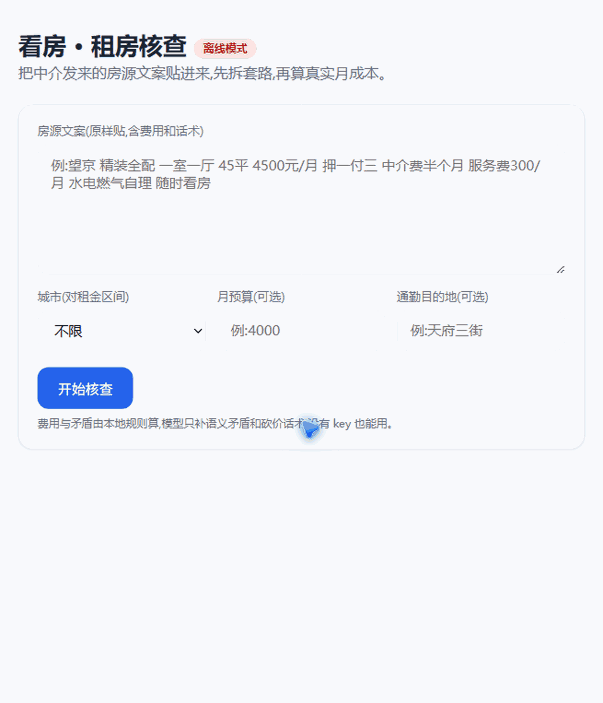
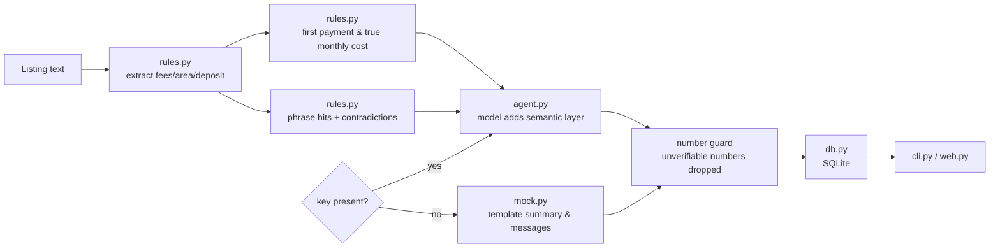

# KanFang · Rental Listing Checker

[](https://github.com/wushiyi105-jpg/kanfang/actions) []() [](./LICENSE) [](https://codecov.io/gh/wushiyi105-jpg/kanfang)



> Paste the listing text an agent sent you: break down the fees, catch the sales talk, find the contradictions, then get a viewing checklist you can carry and messages you can actually send.

The hard part of renting is not viewing flats — it is **seeing the real cost through asymmetric information**: besides rent there are service fees, agency fees, utilities; different deposit arrangements change the first payment by thousands; and every phrase like "viewing anytime", "the only one left", "direct from the landlord" maps to a known trick. KanFang takes the listing apart, keeps the arithmetic local, and turns the checks into a list.

**CLI + Web, zero third-party dependencies.**

## ✨ Features

- 💰 **Fee recalculation** — pull rent, deposit/payment terms, agency fee, service fee, property fee, internet and utilities out of the text, then compute the **first payment** and the **true monthly cost** (first-year total ÷ 12), each line linked to its original snippet
- 🧾 **Sales-talk detection** — 40 built-in agent phrases with what they actually mean; "viewing anytime" is lead generation, "no agency fee" is usually a renamed charge, each hit carries a risk level
- ⚠️ **Contradiction checks** — area vs layout, rent vs city price range, "direct from landlord" vs an agency fee, "no agency fee" vs a service fee, whole-flat vs shared, all run locally first
- 🏠 **Viewing checklist** — questions grouped by room / fees / contract, each tied to a specific risk; add a commute destination and a real-commute check is inserted
- ✍️ **Negotiation messages** — 2–3 sendable messages built from the problems found, using only numbers from the fee table
- 📄 **Contract clauses** — 15 clauses to get in writing before signing, grouped by money / fees / living / rights / move-out
- 🗂 **Side-by-side records** — `--save` stores listings in local SQLite, `history` lines up rent and true cost
- ⚡ **Offline capable** — without a key the fees, phrases, contradictions and checklist still work; only semantic contradictions and message rewriting need the model

## 🚀 Quick start

```bash
git clone https://github.com/wushiyi105-jpg/kanfang.git
cd kanfang

# optional: model key (works without one in offline mode)
cp .env.example .env       # edit .env and set LLM_API_KEY

python -m kanfang scan --text "Wangjing, one-bedroom, 45 sqm, 4500 CNY/month, deposit 1 pay 3, agency fee half month, service fee 300/month" --city Beijing --budget 4000
```

The first run creates `data/kanfang.db`; no pip install needed.

> No API key ships with the project. `.env` is gitignored.

Docker (the image is built and pushed to GHCR on every tag):

```bash
docker pull ghcr.io/wushiyi105-jpg/kanfang:0.1.0
docker run -p 8000:8000 ghcr.io/wushiyi105-jpg/kanfang:0.1.0
```

Build locally with `docker build -t kanfang . && docker run -p 8000:8000 kanfang`.

## 🧪 Examples: run the real cases

`examples/` holds 4 anonymised real listings; `examples/out/` holds the actual output produced on 2026-11-26 in offline mode, so it is reproducible.

```bash
python -m kanfang --mock scan --file examples/case-01.txt --city 北京 --budget 4000
```

Output (excerpt, verbatim Chinese output, full file at [`examples/out/case-01.md`](./examples/out/case-01.md)):

```
💰 费用表(本地复算)
  · 月租:4500 元    ← 4500元/月
  · 押金:4500 元    ← 押 1 个月
  · 首期租金:13500 元    ← 押一付三
  · 中介费:2250 元    ← 中介费半个月
  · 服务费:300 元/月    ← 服务费300元/月
  · 真实月成本:4988 元  (首年总额 ÷ 12,含一次性中介费)
  · 首次支付:20250 元  (首期租金 + 押金 + 中介费)
```

## 🤔 Why not just ask a general LLM

A general model can read a listing and say "watch out for the deposit and agency fee". KanFang adds the four things it cannot:

1. **The arithmetic can be rechecked** — first payment and true monthly cost come from fixed formulas computed locally: first year = rent×12 + agency fee + monthly fees×12, divided by 12; first payment = first rent instalment + deposit + agency fee. The same text yields the same numbers twice and can be unit-tested; a general model's "around four thousand something" drifts every call.
2. **Data stays local** — listings you checked, your budget and the computed costs live in `data/kanfang.db`. A model call sends only this listing and its fee table, not your history, and never the database.
3. **Offline capable** — without a key, all 40 phrases, the contradiction rules, the three checklists, 15 contract clauses and the negotiation templates still run; a general chat model simply stops.
4. **Output can be traced back** — every fee line carries its original snippet ("agency fee half month", "service fee 300/month"), every contradiction names its evidence ("1 bedroom / 45 sqm"), and every number inside the negotiation text passes a guard; numbers absent from the fee table send the whole sentence back to the local template. A general chat answer offers no such anchors.

## 🎯 Use cases

- **Renting for the first time after graduation**: `scan --save` three listings an agent sent, then `history` lines up their true monthly costs and pick which ones are actually inside your budget, instead of being pulled in by a low "deposit 1 pay 1" headline.
- **Ten minutes before a viewing**: paste the text, take the checklist, and tick room / fees / contract items on site — water pressure, soundproofing and the deposit refund deadline no longer get buried under sales talk.
- **Right before signing**: run `clauses` through the 15 items that belong in the contract and ask for verbal promises to be attached in writing; if a sub-landlord is suspected, verify the title deed, ID and authorisation letter together.

## 🗺 Roadmap

- **Multi-listing comparison view**: `history` currently prints one summary line; next is a table comparing rent, true cost, first payment and problem count, sortable by budget.
- **Clauses tied to the listing**: turn `clauses` from a fixed list into "clauses this flat must add" — basements, partitioned flats and sub-landlords each get different must-haves.
- **Measured commute time**: connect a routing API so "real commute to X" becomes a computed number of minutes instead of a checklist item.
- **Utility rate estimation**: estimate monthly utilities from city residential/commercial rates and typical usage, folding "tenant pays" into the true monthly cost.
- **Screenshot input**: support pasting chat screenshots through an optional vision-model endpoint, with the step clearly marked as requiring a key.

## ❓ FAQ

**Where do I get an API key?**
Fees, phrases, contradictions and the checklist need none. Only semantic contradictions and negotiation rewriting call a model; the default is DeepSeek (`https://api.deepseek.com`) — put the key in `.env` as `LLM_API_KEY` or pass `--api-key`. Any OpenAI-compatible endpoint works.

**Where is data stored, and is it uploaded?**
`data/kanfang.db` by default (one SQLite file); override with `KANFANG_DB` or `--db`. It stores a listing excerpt, rent, true monthly cost and the report JSON; a model call sends only the current text and fee table.

**Does it work without a key?**
Yes. Fee recalculation, the 40 phrases, contradiction rules, the three checklists, 15 clauses and negotiation templates all run locally; `scan` returns the same structure, with template wording instead of model wording.

**How do I switch models?**
Set `LLM_BASE_URL`, `LLM_MODEL` and `LLM_API_KEY`, or override with `--model` / `--base-url`, no code change.

**Can the model invent prices?**
The negotiation layer has a number guard: every number in a message must exist in the fee table (rent, area, monthly cost, first payment, fees, deposit/payment months), otherwise the sentence is dropped; if everything is dropped it falls back to local templates and says so.

## 📖 Commands

```bash
# 🏠 check a listing (city drives the price-range comparison)
python -m kanfang scan --text "..." --city Chengdu --budget 2500 --commute Tianfu Third Street

# read from a file and store it for comparison
python -m kanfang scan --file listing.txt --save

# 📄 pre-signing clauses (15, grouped)
python -m kanfang clauses

# 🧾 phrase library (filterable)
python -m kanfang talks --grep deposit

# 🗂 listings checked so far
python -m kanfang history --limit 10

# 🌐 web UI at http://127.0.0.1:8000
python -m kanfang web --port 8000

# global
python -m kanfang --json scan --text "..."   # raw JSON
python -m kanfang --mock scan --text "..."   # force offline mode
```

## 🔌 Model configuration

Works with any **OpenAI-style `/chat/completions`** endpoint, using your own key:

| Platform | `LLM_BASE_URL` | `LLM_MODEL` |
|---|---|---|
| DeepSeek (default) | `https://api.deepseek.com` | `deepseek-flash` |
| OpenAI | `https://api.openai.com/v1` | `gpt-4o-mini` |
| Local Ollama | `http://localhost:11434/v1` | `qwen2.5` |
| Other gateways | gateway URL | gateway model |

## 🧠 How it works

One `scan` splits the work: everything computable is computed locally, the model only adds semantics.

```
listing text + city + budget + commute
   │
   ├─ rules.parse_listing ── regex rent / deposit / area / fees → first payment, true monthly cost
   ├─ rules.hit_talks ─────── 40 phrases matched by substring, sorted by risk
   ├─ rules.find_contradictions ── area vs layout, city price range, identity vs fees
   ├─ rules.build_checklist ── room / fees / contract groups, each with a risk
   │
   ├─ model (key present): semantic contradictions (quotes must exist in the text) + extra questions + negotiation
   └─ offline (no key): mock.py fills summary and messages from templates
   │
   └─ number guard → SQLite → CLI / Web
```

### Data flow



## 🗂 Layout

```
kanfang/
├── kanfang/
│   ├── rules.py      # fee parsing, cost formulas, phrases, contradictions, checklist
│   ├── agent.py      # orchestration: local rules + model layer + number guard
│   ├── mock.py       # offline mode: template summary and messages
│   ├── llm.py        # LLM client (OpenAI-style + .env + empty/length retry)
│   ├── db.py         # SQLite (thread-safe) for listings and reports
│   ├── cli.py        # scan / clauses / talks / history / web
│   └── web.py        # single page + JSON API
├── data/
│   ├── talks.json        # 40 agent phrases
│   ├── traps.json        # 15 contract traps
│   └── rent_tiers.json   # rent ranges for 10 cities
├── examples/             # 4 anonymised listings + out/ actual reports
├── tests/
│   ├── test_kanfang.py       # 26 offline unit tests
│   └── test_integration.py    # 10 integration tests (HTTP / fake model / CLI)
├── assets/demo.gif       # 1080 px wide, 31 frames, 9.9 s
├── Dockerfile / .dockerignore
└── README.md / README.en.md
```

## ✅ Tests

```bash
python -m unittest discover tests -v
```

36 tests in two layers:

- **Unit (26)**: fee parsing, cost formulas, phrases, contradictions, checklist, number guard, offline pipeline — no tokens spent.
- **Integration (10)**: a real `ThreadingHTTPServer` on a random port receiving `POST /api/scan` and asserting `monthly_cost=4988`, `first_payment=20250`, 15 clauses and a stored id; a fake OpenAI-compatible server feeding back a quote that is not in the source text and an invented 3800 offer, asserting the quote is dropped, the invented number is discarded and the local template takes over; `subprocess` CLI e2e asserting exit codes and stdout lines.

CI runs the same suite on Python 3.10 / 3.11 / 3.12 and records coverage with codecov.

## 👤 Author

shiyi · GitHub [@wushiyi105-jpg](https://github.com/wushiyi105-jpg) · [wushiyi105@gmail.com](mailto:wushiyi105@gmail.com)

## 📄 License

[MIT](./LICENSE)
