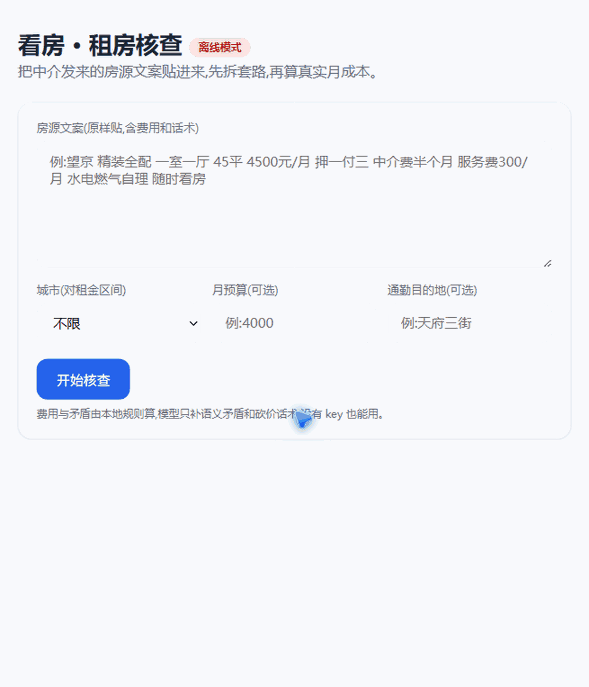
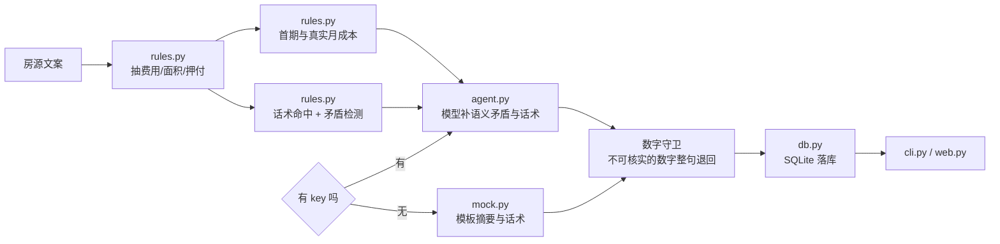

# 看房 KanFang · 租房文案核查 Agent

[](https://github.com/wushiyi105-jpg/kanfang/actions) []() [](./LICENSE) [](https://codecov.io/gh/wushiyi105-jpg/kanfang)



> 把中介发来的房源文案原样贴进来:先拆费用、识话术、找前后矛盾,再给一份能带去现场的看房清单和能直接发出去的砍价话术。

租房最难的不是看房,是**在信息不对称的情况下算清这笔账**:月租之外还有服务费、中介费、水电燃气,押付方式不同首期差出一大截;文案里的「随时看房」「仅此一套」「房东直租」每一句都有对应的套路。看房把这些拆开,把数字留在本地算,把核查动作变成清单。

**CLI + Web 双入口,零第三方依赖。**

## ✨ 特性

- 💰 **费用复算** —— 从文案里抽月租、押付、中介费、服务费、物业、网费、水电,算出**首次支付**与**真实月成本**(首年总额 ÷ 12),每一项都挂原文片段
- 🧾 **话术识别** —— 内置 40 条中介话术及真实含义,「随时看房」是引流、「免中介费」常是费用换名,命中即标风险等级
- ⚠️ **矛盾检测** —— 面积与户型、租金与城市区间、房东直租与中介费、免中介费与服务费、整租与合租,本地规则先跑一遍
- 🏠 **看房清单** —— 按房间 / 费用 / 合同三组生成现场问题,每条挂一个风险点;填了通勤目的地会加一条实测通勤
- ✍️ **砍价话术** —— 根据已发现的疑点给 2~3 段可直接发的消息,价格只用费用表里的数字
- 📄 **合同条款** —— 15 条签约前必须写进合同的条款,按钱 / 费用 / 居住 / 权利 / 退租分组
- 🗂 **横向对比** —— `--save` 存进本地 SQLite,`history` 把几套房的月租与真实成本排在一起
- ⚡ **离线可用** —— 没有 key 时费用、话术、矛盾、清单照样出,只有语义矛盾和话术改写需要模型

## 🚀 快速开始

```bash
git clone https://github.com/wushiyi105-jpg/kanfang.git
cd kanfang

# 可选:配置模型 key(不配也能用,走离线模式)
cp .env.example .env       # 编辑 .env 填入 LLM_API_KEY

python -m kanfang scan --text "望京 精装全配 一室一厅 45平 4500元/月 押一付三 中介费半个月 服务费300/月 水电燃气自理 随时看房" --city 北京 --budget 4000
```

首次运行会在 `data/kanfang.db` 建库,不需要 pip install。

> 项目不自带任何 API key。`.env` 已 gitignore,不会提交。

Docker 运行(镜像由 CI 推到 GHCR,每次打 tag 自动构建):

```bash
docker pull ghcr.io/wushiyi105-jpg/kanfang:0.1.0
docker run -p 8000:8000 ghcr.io/wushiyi105-jpg/kanfang:0.1.0
```

自己构建:`docker build -t kanfang . && docker run -p 8000:8000 kanfang`。

## 🧪 示例:拿真实文案跑一遍

`examples/` 里放了 4 份脱敏过的真实房源文案,`examples/out/` 是对应的实际输出(2026-11-26 跑出,离线模式,可复现)。

```bash
python -m kanfang --mock scan --file examples/case-01.txt --city 北京 --budget 4000
```

跑出来是这样(节选,完整见 [`examples/out/case-01.md`](./examples/out/case-01.md)):

```
💰 费用表(本地复算)
  · 月租:4500 元    ← 4500元/月
  · 押金:4500 元    ← 押 1 个月
  · 首期租金:13500 元    ← 押一付三
  · 中介费:2250 元    ← 中介费半个月
  · 服务费:300 元/月    ← 服务费300元/月
  · 真实月成本:4988 元  (首年总额 ÷ 12,含一次性中介费)
  · 首次支付:20250 元  (首期租金 + 押金 + 中介费)

⚠️  疑点(2)
  1. [高] 身份与收费:写着「房东直租」却收中介费
     原文:中介费半个月
```

| 文件 | 场景 | 关注点 |
|---|---|---|
| `case-01.txt` | 望京 45㎡ 一室一厅,中介费半个月 | 身份与收费矛盾、超预算 |
| `case-02.txt` | 成都 合租主卧 18㎡,「无中介费」+ 服务费/物业 | 费用换名、合租边界 |
| `case-03.txt` | 深圳 南山 两室一厅 68㎡,押二付一 | 首期支付、月度物业网费 |
| `case-04.txt` | 上海 徐汇 一室户 32㎡,免中介费 + 服务费 | 折算单价、服务费占比 |

四份输入都是纯文本,输出里每个数字都挂着原文片段,可以逐条回指核对。

## 🤔 为什么不用通用大模型直接问

通用模型能读一段房源文案然后说「注意押金和中介费」,但看房补的是它做不到的四件事:

1. **费用能复算** —— 首月支出、真实月成本、每平米单价都由固定公式在本地算:首年 = 月租×12 + 中介费 + 按月费用×12,再除以 12;首期 = 首期租金 + 押金 + 中介费。同一段文案跑两次结果一样,能写进测试;通用模型每次给的「大概四千多」都不一样。
2. **数据留在本地** —— 看过的房源、你填的预算、算出来的成本都进 `data/kanfang.db`。调用模型时只发这一段文案和费用表,不发历史房源,也不上传数据库。
3. **离线可用** —— 没配 key 时 40 条话术、矛盾规则、三组看房清单、15 条合同条款、砍价模板全部照跑;通用对话离线就断。
4. **输出可回指** —— 每一项费用都带原文片段(「中介费半个月」「服务费300/月」),每条矛盾都指出依据(「一室一厅 / 45平」),话术里出现的数字还要过一道守卫,不在费用表里的数字整句退回本地模板;通用对话给不了这种可核对的落点。

## 🎯 适用场景

- **刚毕业第一次租房**:把中介发的三套文案分别 `scan --save`,用 `history` 把真实月成本排一排,先看哪套在自己预算内,再决定去看哪套,而不是被「押一付一」的低门槛带跑。
- **看房前十分钟**:把文案贴进去拿一份清单,到现场按「房间 / 费用 / 合同」逐条打勾,水压、隔音、押金退还时限这些容易被话术盖过去的点不会漏。
- **准备签约**:先用 `clauses` 过一遍 15 条该写进合同的内容,把口头承诺要求写成附件;怀疑二房东时重点核对产权证、身份证、委托书三样。

## 🗺 Roadmap

- **多套房对比视图**:`history` 现在只列一行摘要,下一步给月租、真实成本、首期、疑点数并排的对比表,并支持按预算排序。
- **合同条款与房源联动**:把 `clauses` 从固定清单变成「这套房必须补的条款」,例如地下室、隔断房、二房东各生成不同的必写项。
- **通勤时间实测**:接入地图路线接口,把「到 XX 的实际通勤」从清单里的待办变成算出来的分钟数。
- **水电单价核算**:按城市民用/商用价与历史用量估算月度水电,把「自理」折算进真实月成本。
- **文案截图识别**:支持直接贴聊天截图,本地 OCR 不可行,改为可选的视觉模型接口,并明确标注这一步需要 key。

## ❓ FAQ

**API key 从哪来?**
费用、话术、矛盾、清单都不需要 key。只有语义矛盾补充与砍价话术改写会调模型,默认接 DeepSeek(`https://api.deepseek.com`),注册后把 key 填进 `.env` 的 `LLM_API_KEY`,或 `--api-key` 临时传入。任何 OpenAI 风格接口都能换。

**数据存在哪,会不会上传?**
默认 `data/kanfang.db`(单个 SQLite 文件),可用 `KANFANG_DB` 或 `--db` 换路径。存的是房源原文摘要、月租、真实月成本与报告 JSON;调模型时只发当前这段文案与费用表。

**没有 key 还能用吗?**
能。费用复算、40 条话术、矛盾规则、三组清单、15 条条款、砍价模板全部本地完成,`scan` 输出结构完全一样,只是摘要和话术是模板而不是模型写的。

**怎么换模型?**
改 `LLM_BASE_URL`、`LLM_MODEL`、`LLM_API_KEY` 三个环境变量,或用 `--model` / `--base-url` 临时覆盖,不用改代码。

**模型会不会编价格?**
话术层有数字守卫:消息里每个数字都必须在费用表里找得到(月租、面积、月成本、首付、各项费用、押付月数),否则整句丢掉;全被丢掉就退回本地模板,并在结果里注明。

## 📖 命令参考

```bash
# 🏠 核查一段房源文案(城市用于租金区间对照)
python -m kanfang scan --text "..." --city 成都 --budget 2500 --commute 天府三街

# 从文件读,并存入本地便于对比
python -m kanfang scan --file 房源.txt --save

# 📄 签约前条款(15 条,分组显示)
python -m kanfang clauses

# 🧾 话术库(可按关键词过滤)
python -m kanfang talks --grep 押金

# 🗂 看过的房源
python -m kanfang history --limit 10

# 🌐 Web(浏览器打开 http://127.0.0.1:8000)
python -m kanfang web --port 8000

# 全局
python -m kanfang --json scan --text "..."   # 原始 JSON
python -m kanfang --mock scan --text "..."   # 强制离线模式
```

## 🔌 模型接入

兼容任意 **OpenAI 风格 `/chat/completions`** 接口,使用你自己的 key:

| 平台 | `LLM_BASE_URL` | `LLM_MODEL` |
|---|---|---|
| DeepSeek(默认) | `https://api.deepseek.com` | `deepseek-flash` |
| OpenAI | `https://api.openai.com/v1` | `gpt-4o-mini` |
| 本地 Ollama | `http://localhost:11434/v1` | `qwen2.5` |
| 其他兼容网关 | 网关地址 | 网关模型名 |

## 🧠 工作原理

一次 `scan` 的分工:能算的本地算死,模型只补语义层。

```
房源文案 + 城市 + 预算 + 通勤
   │
   ├─ rules.parse_listing ── 正则抽月租/押付/面积/各项费用 → 首期、真实月成本
   ├─ rules.hit_talks ─────── 40 条话术子串命中,按风险排序
   ├─ rules.find_contradictions ── 面积户型、城市单价区间、身份与收费
   ├─ rules.build_checklist ── 房间/费用/合同三组,每条挂风险
   │
   ├─ 模型(有 key):语义矛盾(引用必须能在原文找到)+ 补充问题 + 砍价话术
   └─ 离线(无 key):mock.py 用模板补摘要与话术
   │
   └─ 数字守卫 → SQLite 落库 → CLI / Web 输出
```

### 数据流



## 🗂 目录结构

```
kanfang/
├── kanfang/
│   ├── rules.py      # 费用解析、成本公式、话术命中、矛盾检测、清单
│   ├── agent.py      # 编排:本地规则打底 + 模型语义层 + 数字守卫
│   ├── mock.py       # 离线模式:模板摘要与砍价话术
│   ├── llm.py        # LLM 客户端(OpenAI 风格 + .env + 空响应/截断重试)
│   ├── db.py         # SQLite(线程安全),存看过的房源与报告
│   ├── cli.py        # scan / clauses / talks / history / web
│   └── web.py        # 单页 + JSON API
├── data/
│   ├── talks.json        # 40 条中介话术
│   ├── traps.json        # 15 条合同陷阱
│   └── rent_tiers.json   # 10 城租金区间
├── examples/             # 4 份脱敏文案 + out/ 实际输出
├── tests/
│   ├── test_kanfang.py       # 26 个离线用例(纯函数)
│   └── test_integration.py    # 10 个集成用例(HTTP / 假模型 / CLI)
├── assets/demo.gif       # 1080 宽,31 帧,9.9 秒
├── Dockerfile / .dockerignore
└── README.md / README.en.md
```

## ✅ 测试

```bash
python -m unittest discover tests -v
```

36 个用例分两层:

- **纯函数(26)**:费用解析、成本公式、话术命中、矛盾检测、清单、数字守卫、离线流水线,不花 token。
- **集成(10)**:真起 `ThreadingHTTPServer` 在随机端口发 `POST /api/scan`,断言 `monthly_cost=4988`、`first_payment=20250`、15 条条款与落库 id;起一个假的 OpenAI 兼容服务,喂回不在原文里的矛盾引用和编造的 3800 元报价,断言引用被丢弃、编造数字整句退回、全被退回时回落到本地模板;`subprocess` 跑 CLI,e2e 断言退出码与 stdout 关键行。

CI 在 Python 3.10 / 3.11 / 3.12 上跑同一组测试,并用 codecov 记录覆盖率。

## 👤 作者

shiyi · GitHub [@wushiyi105-jpg](https://github.com/wushiyi105-jpg) · [wushiyi105@gmail.com](mailto:wushiyi105@gmail.com)

## 📄 License

[MIT](./LICENSE)
